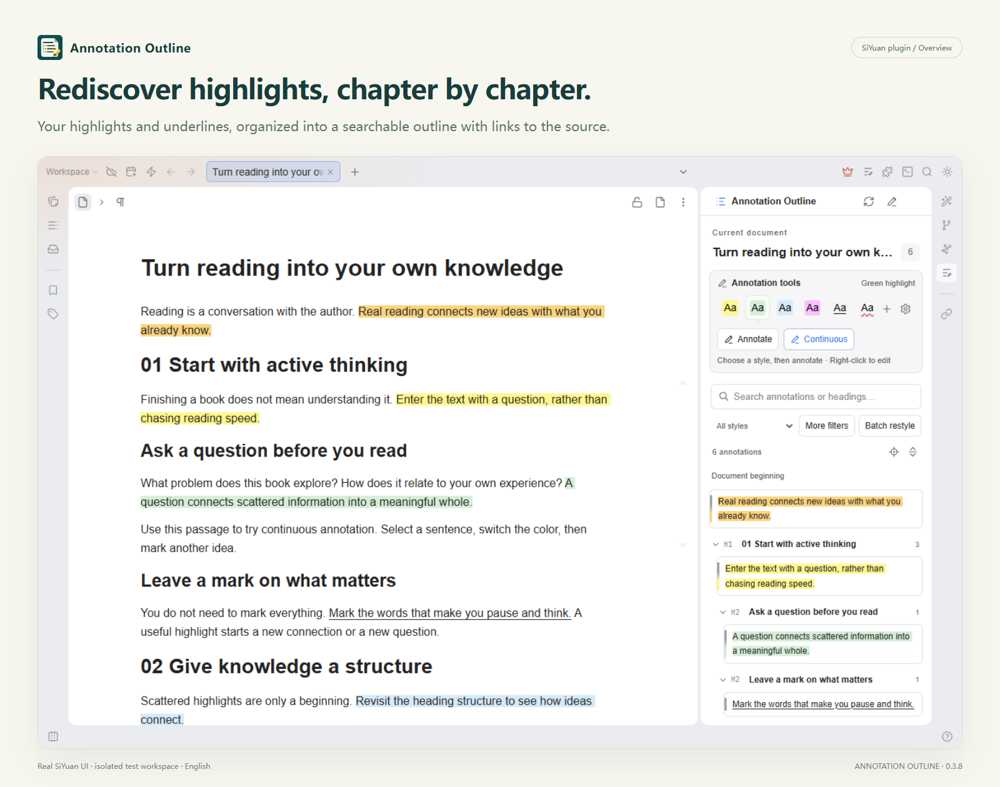
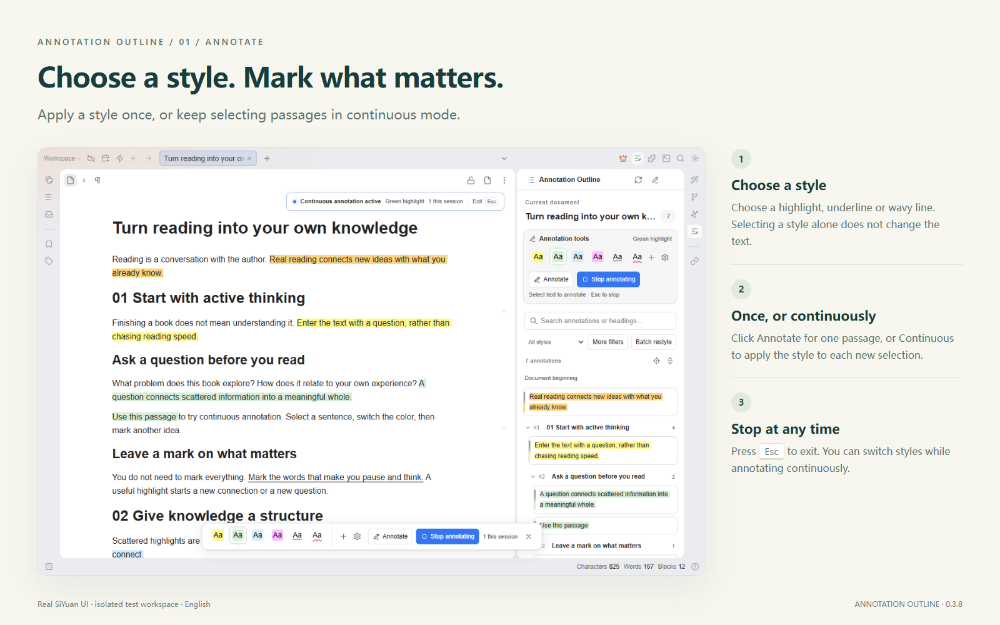
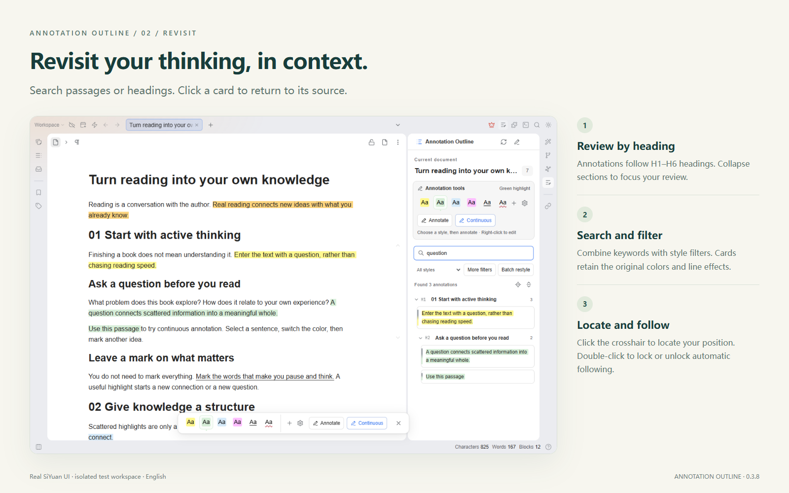
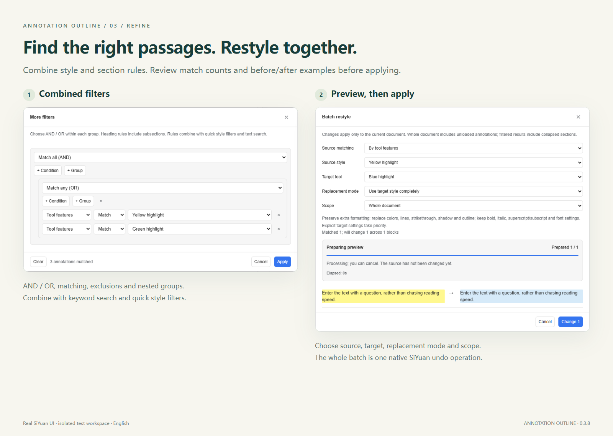
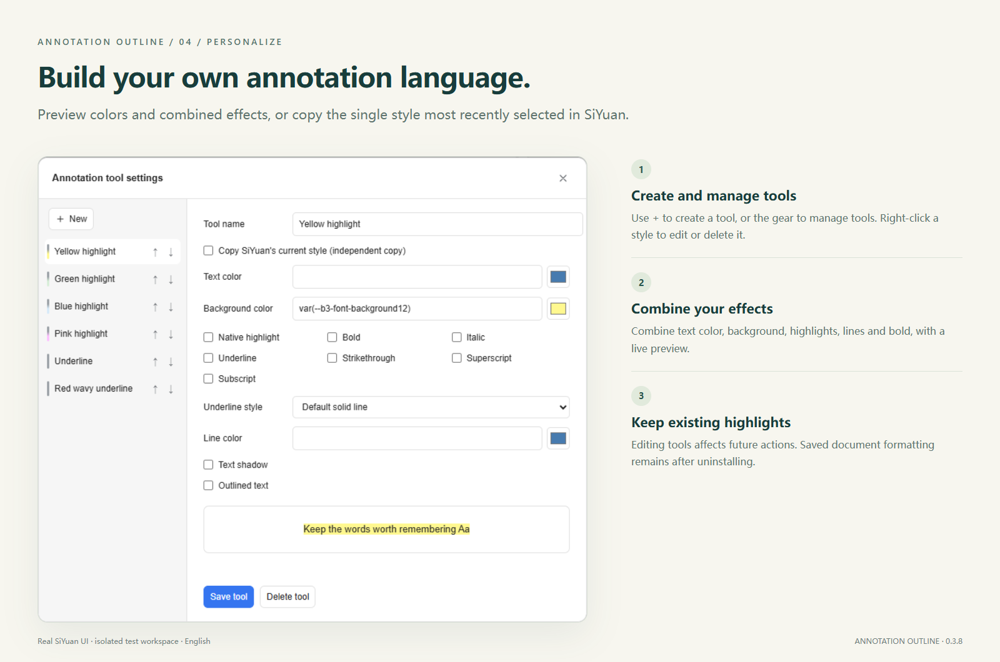
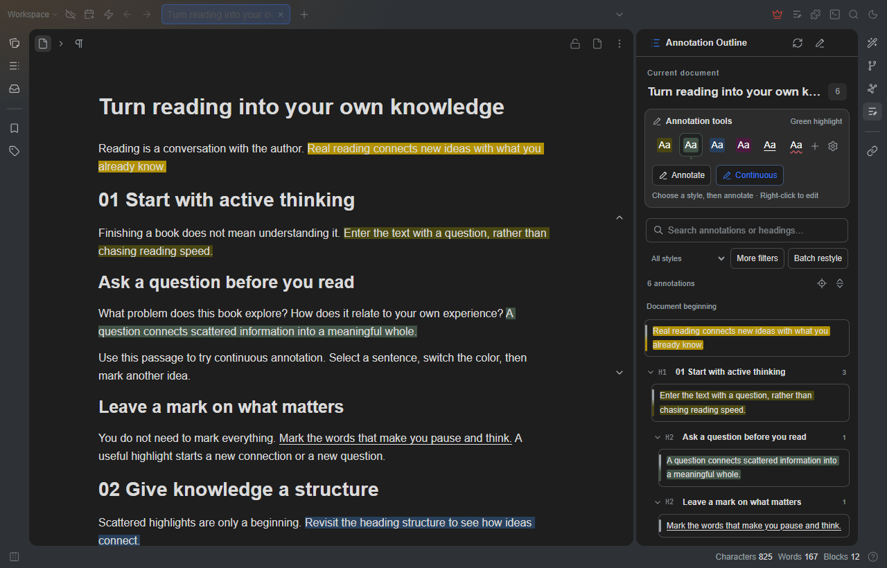

# Annotation Outline · 标注大纲

**Turn highlights into a structured review.**

Annotation Outline is a desktop plugin for SiYuan Note. It collects highlights, text colors and underlines from your current document into a heading-based sidebar. Mark important passages while reading, then revisit them in context and click a card to return to the source.

[简体中文](README.md) · [Development and validation (Chinese)](docs/DEVELOPMENT.md)

> Images were captured in an isolated SiYuan 3.8.10 test workspace, using the real editor, built-in themes and dedicated sample documents. Screenshots use SiYuan's desktop browser interface. Appearance varies with the SiYuan version and theme.

## Features

- **Review by heading:** H1–H6 hierarchy, collapsible sections, search, style filters and navigation back to the source.
- **One-time or continuous annotation:** choose a style, apply it once, or keep selecting passages in continuous mode. Press `Esc` to exit.
- **Recognizable cards:** retain text colors, backgrounds and line effects from the source.
- **Follow your reading position:** click the crosshair to locate nearby annotations; double-click to lock automatic following, and double-click again to unlock.
- **Combined filters:** match tool features, exact styles, colors, line effects, formatting or sections. Combine AND/OR groups and exclusions with search.
- **Preview style changes:** replace one annotation from its context menu or change the entire document/current filtered results in a batch. Review counts and before/after examples before confirming.

Only the **current document** is indexed, rather than the whole notebook or workspace.

## 1. Choose a style and annotate

Open a document and the Annotation Outline dock on the right. Select a style in the toolbar.

- **Annotate once:** click “Annotate” to apply to an existing selection. Without a selection, the tool waits for your next selection and exits after one annotation.
- **Continuous annotation:** click “Continuous”, then select passages repeatedly. Switch styles while working. Press `Esc` or click the stop button to finish.

Choosing a style alone does not change an existing selection or enable continuous annotation. The dock's pen button opens a floating toolbar; the SiYuan top-bar button and shortcut can also toggle it.

## 2. Review in context

Cards are organized under their headings. Empty branches are hidden. Search annotation text or heading names, combine search with a quick style filter, and click a card to return to the source.

The crosshair locates the annotation under the cursor or a nearby annotation in the same section. Double-click to enable automatic following. If filters hide the target, the plugin asks you to clear them without changing them automatically.

## 3. Filter and change styles

Open “More filters” to create conditions and nested groups. Use AND/OR, matching and exclusions. Section conditions include child sections; the dialog previews the number of matches.

Open “Batch restyle” to choose a source style, target tool, replacement mode and scope. Review the actual change count and before/after examples, then confirm.

- **Use the target style completely:** replace annotation formatting with the target tool.
- **Preserve extra formatting:** replace colors, line effects and related annotation effects while preserving bold, italic, superscript/subscript and font settings; explicit target settings take priority.

You can also right-click a card to change it or prefill a batch for its exact style. A batch is saved as one native SiYuan undo operation. Preparation and validation can be canceled; once saving starts, wait for completion. Large batches take longer to save.

## 4. Customize your tools

Four highlight colors, underline and a red wavy underline are included. Use `+` to add a tool, the gear to manage tools, or right-click a style to edit or delete it. Names, order, colors and combined effects can be previewed while editing.

The inherit option copies the single style most recently selected in SiYuan's text-style panel into an independent tool.

Editing or deleting a tool affects future actions. Existing document formatting remains unchanged, including after uninstalling the plugin. Use card replacement or batch changes to update existing annotations.

## Light and dark appearances

Default tools use SiYuan theme color variables. Inherited or explicitly fixed colors retain their saved values. Third-party themes can produce different results.

## Installation and compatibility

Current version: **0.3.8**. Declared minimum SiYuan version: **3.2.0**. Native annotation and saving behavior was previously validated in an isolated SiYuan **3.8.10** workspace. The new Chinese and English screenshots come from that workspace, with continuous annotations checked against native saved content. Demo-host browser regression checks also pass. Older versions show an error if a necessary style API is unavailable.

**Chinese and English interfaces are supported.** The plugin follows SiYuan's interface language. Change SiYuan's language and restart as prompted. The sidebar, toolbar, filters, batch changes, tool settings and messages are localized. Custom tool names and document content stay as you wrote them.

Supports desktop, desktop browser and desktop windows; dock support in separate windows depends on SiYuan. Mobile and PDF-canvas annotations are outside this version's scope. Cross-device synchronization, third-party themes and multiwindow combinations require further testing in your environment.

Once listed, search for “标注大纲” in Settings → Bazaar → Plugins. For manual installation:

1. Extract the release attachment `package.zip` into `data/plugins/sy-annotation/` in your workspace.
2. Keep `plugin.json`, `index.js`, `index-worker.js` and `index.css` directly inside that directory.
3. Enable the plugin in the downloaded-plugins tab. Disable before upgrading, replace files, then enable again.

Tool settings are stored in `data/storage/petal/sy-annotation/tools.json`. Continuous annotation and automatic following do not resume automatically after restart.

| Action | Windows / Linux | macOS |
| --- | --- | --- |
| Toggle floating toolbar | Alt + Shift + H | Option + Shift + H |
| Toggle continuous annotation | Ctrl + Alt + H | Cmd + Option + H |
| Annotate once | Alt + Shift + M | Option + Shift + M |
| Exit waiting / continuous mode | Esc | Esc |

## Scope

- Only editable document text can be annotated. Code/HTML/embed blocks, databases, inline formulas and read-only content are excluded.
- Plain bold or italic text is not collected by default. Recognizable colors, highlights, lines and combinations matching custom tools are collected.
- Adjacent segments with the same formatting may merge. Different line effects remain separate. The sidebar counts actual segments, which can differ from the number of annotation actions.
- No additional annotation service is required. The plugin reads the current document and saves native text formatting through SiYuan's APIs.

[Development and validation (Chinese)](docs/DEVELOPMENT.md) · [MIT License](LICENSE) · [Third-party notices](THIRD_PARTY_NOTICES.md)
